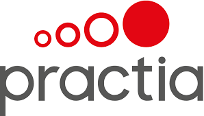

# Grupo Petersen - Migración 

Proyecto para la migracion de GP-TOSCA a MADRID.

 

# Pre-requisitos
+ Madrid 1.0
* Se requiere conexion a la VPN de GP
* Abrir el archivo `settings.gradle` desde IntelliJ
* Buscar el parametro `browserName` y colocarle el nombre del navegador (**firefox** / **chrome**)

Como primera vez seleccionaremos la opción **Run > Edit Configurations…** y nos abrirá una ventana la cual debemos agregar una nueva configuración de tipo
**Gradle**, en el *Gradle Project* dar click en el icono de la carpeta y seleccionar `UIAutomation`, configurar el *Tasks* con `gpTest` y 
en *Arguments* colocar:

	-Dwebdriver.chrome.driver=drivers/chromedriver.exe --info (para Chrome)
	-Dwebdriver.gecko.driver=drivers/geckodriver.exe --info (para Firefox)

Seleccionar el Task *UIAutomation[gpTest]*  en la lista de Task de Gradle y ejecutar con el boton verde de Play.

# Visualizar Reporte
* Para la configuracion inicial, sera necesario ir a la opcion de Gradle ubicada en el lateral derecho de la IDE, seleccionar la carpeta *Tasks* > *other* 
y seleccionar la opcion **downloadAllure**.
* Luego de haber realizado la configuracion inicial y despues de haber ejecutado nuestros Test (ver paso anterior) podemos ejecutar el Task **allureServer**
que nos abrira un browser con el Reporte de Allure.
