# Design Document: Pipeline Run Identification

## Overview

This feature adds a `RUN_NAME` variable to the existing GitLab CI pipeline for the hbi-api project, enabling clear identification and organization of parallel pipeline executions. The implementation modifies `.gitlab-ci.yml` to declare, validate, and propagate the variable through test execution and artifact storage.

The pipeline is responsible only for:
- Declaring `RUN_NAME` as a top-level pipeline variable (accessible via GitLab API)
- Validating the variable value
- Propagating it to Gradle as a system property
- Organizing artifacts under RUN_NAME-scoped directories

Report unification is handled by an **external application** that queries the GitLab API to discover pipelines by `RUN_NAME`, downloads their artifacts, and produces unified reports outside of CI.

## Architecture

```mermaid
flowchart TD
    subgraph "GitLab CI Pipeline"
        A[Pipeline Trigger] --> B[Variable Declaration & Validation]
        B -->|valid| C[run_tests job]
        B -->|invalid| X[Fail with error message]
        C --> D[generate_report job]
    end

    subgraph "run_tests job"
        C1[Validate RUN_NAME] --> C2[Write environment.properties]
        C2 --> C3[Execute Gradle with -DrunName]
        C3 --> C4[Move artifacts to RUN_NAME paths]
    end

    subgraph "generate_report job"
        D1[Read allure-results from RUN_NAME path]
        D1 --> D2[Generate Allure report to allure-report-RUN_NAME/]
    end

    subgraph "External App (outside pipeline)"
        F1[Query GitLab API for pipelines by RUN_NAME]
        F1 --> F2[Download artifacts from matching pipelines]
        F2 --> F3[Unify reports externally]
    end
```



### Design Decisions

1. **Shell-based validation** — No additional runtime dependencies are introduced. The validation uses POSIX regex matching (`grep -E`) available in the base Docker image. This avoids installing Python/Ruby/Node for a CI-only concern.

2. **Validation-first approach** — `RUN_NAME` is validated at the very beginning of the `before_script` in `run_tests`. If validation fails, the job exits immediately before any resource-intensive operations (DNS setup, Gradle execution).

3. **Post-execution artifact relocation** — Rather than modifying Gradle's output directories (which would require `build.gradle` changes), artifacts are moved to RUN_NAME-scoped directories in an `after_script` block. This keeps the build system unchanged.

4. **Top-level variable for API accessibility** — `RUN_NAME` is declared in the top-level `variables:` section of `.gitlab-ci.yml`. GitLab automatically exposes top-level pipeline variables through its REST API endpoint `GET /projects/:id/pipelines/:pipeline_id/variables`, allowing the external application to query and filter pipelines by run name without any additional configuration.

5. **No masking or protection** — The variable is intentionally not marked as `masked` or `protected` so that the external application can freely read it via the GitLab API. Masking would redact the value in API responses.

## Components and Interfaces

### Component 1: Variable Declaration (`.gitlab-ci.yml` variables section)

**Responsibility:** Declare `RUN_NAME` as a top-level pipeline variable with a default value and description for the GitLab CI trigger form. Being top-level ensures the variable is automatically exposed via the GitLab Pipelines API.

**Interface:**
```yaml
variables:
  RUN_NAME:
    value: "run-${CI_PIPELINE_ID}"
    description: "Identifies this parallel test execution. Used in artifact paths and by external report unification."
```

**GitLab API Accessibility:** Once declared at the top level, the variable is queryable at:
- `GET /projects/:id/pipelines/:pipeline_id/variables` — returns `RUN_NAME` and its value
- Works regardless of trigger method (manual, API, schedule)
- Not masked or protected, so the value is readable without restriction

### Component 2: Validation Script

**Responsibility:** Validate `RUN_NAME` against allowed characters and length constraints before any job proceeds.

**Interface (shell function):**
```bash
validate_run_name() {
  local name="$1"
  if [ -z "$name" ]; then
    echo "ERROR: RUN_NAME is required. Cannot be empty or unset."
    exit 1
  fi
  if [ ${#name} -gt 64 ]; then
    echo "ERROR: RUN_NAME exceeds maximum length of 64 characters (got ${#name})."
    exit 1
  fi
  if ! echo "$name" | grep -qE '^[a-zA-Z0-9._-]+$'; then
    echo "ERROR: RUN_NAME contains invalid characters. Allowed: a-z, A-Z, 0-9, hyphen (-), underscore (_), dot (.)"
    exit 1
  fi
}
```

### Component 3: Gradle Propagation (run_tests script section)

**Responsibility:** Pass `RUN_NAME` to the Gradle process and write Allure environment metadata.

**Interface:**
- System property: `-DrunName=${RUN_NAME}` added to ARGS array
- File write: `build/allure-results/environment.properties` containing `run.name=${RUN_NAME}`
- Log output: `echo "Run Name: ${RUN_NAME}"`

### Component 4: Artifact Relocation (run_tests after_script)

**Responsibility:** Move generated artifacts from default Gradle output directories into RUN_NAME-scoped subdirectories.

**Interface:**
```bash
# Move test results
mkdir -p "build/test-results/${RUN_NAME}"
mv build/test-results/*/ "build/test-results/${RUN_NAME}/" 2>/dev/null || true

# Move allure results
mkdir -p "build/allure-results/${RUN_NAME}"
mv build/allure-results/*.json build/allure-results/*.xml build/allure-results/*.properties \
   "build/allure-results/${RUN_NAME}/" 2>/dev/null || true

# Move HTML reports
mkdir -p "build/reports/tests/${RUN_NAME}"
mv build/reports/tests/*/ "build/reports/tests/${RUN_NAME}/" 2>/dev/null || true
```

### Component 5: Generate Report Job (modified)

**Responsibility:** Generate Allure HTML report from RUN_NAME-scoped allure-results directory.

**Interface:**
- **Input:** `build/allure-results/${RUN_NAME}/`
- **Output:** `allure-report-${RUN_NAME}/`

## Data Models

### environment.properties (Allure metadata)

```properties
run.name=regression-sprint42
```

### JUnit XML Format (per test suite, standard Gradle output)

```xml
<?xml version="1.0" encoding="UTF-8"?>
<testsuite name="com.example.TestClass" tests="5" failures="1" errors="0" skipped="1" time="12.345">
  <testcase classname="com.example.TestClass" name="testMethod1" time="2.1"/>
  <testcase classname="com.example.TestClass" name="testMethod2" time="3.4">
    <failure message="Expected X but got Y" type="AssertionError">...</failure>
  </testcase>
</testsuite>
```

### Artifact Directory Structure (per pipeline)

```
build/
├── test-results/
│   └── ${RUN_NAME}/
│       └── TEST-*.xml
├── allure-results/
│   └── ${RUN_NAME}/
│       ├── *.json
│       ├── *.xml
│       └── environment.properties
└── reports/
    └── tests/
        └── ${RUN_NAME}/
            └── (HTML report files)

allure-report-${RUN_NAME}/
└── (generated Allure HTML report)
```

## Correctness Properties

*A property is a characteristic or behavior that should hold true across all valid executions of a system — essentially, a formal statement about what the system should do. Properties serve as the bridge between human-readable specifications and machine-verifiable correctness guarantees.*

### Property 1: RUN_NAME Validation Correctness

*For any* string `s`, the validation function SHALL accept `s` if and only if `s` matches the regular expression `^[a-zA-Z0-9._-]{1,64}$`. That is, valid strings contain only alphanumeric characters, hyphens, underscores, and dots, with length between 1 and 64 inclusive; all other strings SHALL be rejected with an appropriate error message.

**Validates: Requirements 5.1, 5.2, 5.3, 5.4**

### Property 2: RUN_NAME Propagation Correctness

*For any* valid `RUN_NAME` value (matching `^[a-zA-Z0-9._-]{1,64}$`), after the `run_tests` job completes:
- The `environment.properties` file SHALL contain exactly `run.name=<RUN_NAME>`
- Test result artifacts SHALL reside under `build/test-results/<RUN_NAME>/`
- Allure result artifacts SHALL reside under `build/allure-results/<RUN_NAME>/`
- HTML report artifacts SHALL reside under `build/reports/tests/<RUN_NAME>/`

**Validates: Requirements 2.2, 3.1**

## Error Handling

| Scenario | Behavior | Exit Code |
|----------|----------|-----------|
| `RUN_NAME` empty or unset | Log error: "RUN_NAME is required. Cannot be empty or unset." | 1 (job fails) |
| `RUN_NAME` contains invalid characters | Log error listing allowed character set | 1 (job fails) |
| `RUN_NAME` exceeds 64 characters | Log error with max length message | 1 (job fails) |
| Artifact move fails (empty source) | `2>/dev/null || true` — silently continue | 0 (continues) |
| Allure results directory empty/missing | Create empty directory, proceed with Allure generate | 0 (generates empty report) |

### Validation Error Messages

All validation errors follow a consistent format to aid troubleshooting:
```
ERROR: RUN_NAME <specific issue>. <guidance>
```

Examples:
- `ERROR: RUN_NAME is required. Cannot be empty or unset.`
- `ERROR: RUN_NAME contains invalid characters. Allowed: a-z, A-Z, 0-9, hyphen (-), underscore (_), dot (.)`
- `ERROR: RUN_NAME exceeds maximum length of 64 characters (got 78).`

## Testing Strategy

### Property-Based Tests

The feature includes two testable properties suitable for property-based testing:

1. **Validation correctness** — A shell validation function can be extracted and tested with generated strings. Use a property-based testing library (e.g., `fast-check` wrapping shell execution, or a Bash testing framework like `bats` with generated inputs) to verify acceptance/rejection matches the regex `^[a-zA-Z0-9._-]{1,64}$`.

2. **Propagation correctness** — The artifact relocation and environment.properties write logic can be tested by generating valid RUN_NAME values and verifying that output paths and file contents reference the exact value.

**Configuration:**
- Minimum 100 iterations per property test
- Tag format: `Feature: pipeline-run-identification, Property {N}: {description}`

### Unit / Example-Based Tests

| Test | Validates |
|------|-----------|
| Validate RUN_NAME with typical value (e.g., `sprint42-run`) | Req 5.1 |
| Validate RUN_NAME with boundary length 64 | Req 5.1 |
| Reject RUN_NAME with spaces | Req 5.2 |
| Reject RUN_NAME with slashes | Req 5.2 |
| Reject empty RUN_NAME | Req 5.4 |
| Default value contains CI_PIPELINE_ID | Req 1.1, 2.4 |
| environment.properties contains `run.name` key | Req 2.2 |
| Gradle args include `-DrunName` | Req 2.1 |
| RUN_NAME variable is top-level in YAML (not nested in a job) | Req 4.1 |
| RUN_NAME is not masked or protected | Req 4.2 |

### Integration / Pipeline Tests

- Trigger pipeline via API with custom `RUN_NAME`, verify artifacts appear under correct path
- Trigger pipeline via API, query `GET /projects/:id/pipelines/:pipeline_id/variables` and verify `RUN_NAME` is returned
- Trigger pipeline with default `RUN_NAME`, verify it contains pipeline ID
- Trigger two pipelines with same `RUN_NAME`, verify both retain the value in their variable set

### Test Tools

- **Shell script testing:** [bats-core](https://github.com/bats-core/bats-core) for unit testing shell functions
- **Property generation:** Scripts generating random inputs piped to validation function
- **CI validation:** GitLab CI lint API (`/ci/lint`) to validate YAML syntax before merge
